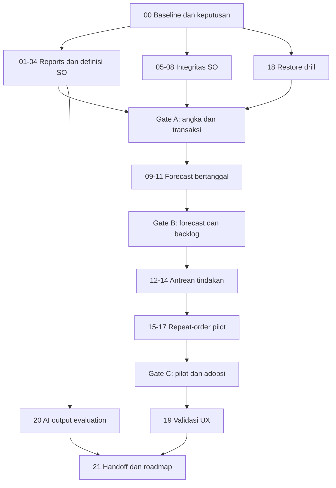

# Plan — CRM Reliability and Growth

Tanggal: 16 Oktober 2026 · Status: **Approved — implementasi belum dimulai**.

[Spec](../specs/crm-reliability-and-growth.md) ·
[Ringkasan](../docs/crm-development-2026-10.md) ·
[Checklist](crm-reliability-and-growth-todo.md)

## 1. Scope dan prinsip pelaksanaan

Disetujui oleh pemilik produk melalui pesan "dokumen approved" pada 16 Oktober 2026.
Approval mencakup paket dokumen dan default D01–D08 sebagai baseline pengembangan.
Implementasi belum dimulai; approval ini tidak membuktikan acceptance criteria
lulus atau memberi izin otomatis untuk migration produksi, push, atau deployment.

D01–D08 sudah diterima; tidak perlu approval ulang untuk keputusan yang sama.
Semua file berstatus sasaran, bukan klaim sudah diubah. `tasks/plan.md` dan
`tasks/todo.md` lama dipertahankan sebagai sejarah.

Kerjakan satu vertical slice lalu buktikan alur sampai UI. Subtask SQL/adapter/UI
boleh dipisah untuk ukuran review, tetapi jangan merilis setengah slice yang
membutuhkan consumer belum tersedia. Ukuran S = 1–2 file; M = 3–5 file; jika
penyelidikan menemukan scope lebih besar, pecah task sebelum implementasi.

Gunakan arsitektur dan RPC yang ada. Tidak ada rewrite atau dependency baru yang
direncanakan. Rencana data/command ada pada ADR-005 Accepted; tidak mengganti ADR-001 sampai ADR-004.

## 2. Dependency dan checkpoint

Reports dan penyelidikan SO bisa disiapkan independen, tetapi task yang mengubah
migration/shared adapter harus berurutan. Diagram bukan instruksi menjalankan
multi-agent. Restore drill dimulai awal dan wajib selesai sebelum migration
produksi. Perubahan application-only yang aman boleh dirilis terpisah.

## 3. Tasks

### 00 — Rekonfirmasi baseline dan keputusan

- **Dependensi:** tidak ada. **Ukuran:** M.
- **Hasil:** catatan source/schema lokal, keputusan D01–D03, dataset regression
  sintetis, serta daftar legacy mismatch yang harus direview tanpa mutation.
- **Files:** spec ini, checklist, laporan baseline baru di `docs/reports/`, fixture
  khusus test (maksimal dua file; jangan memasukkan data produksi pribadi).
- **Acceptance:** keputusan dicatat atau tetap open; status implementasi lokal,
  produksi, dan dokumen dibedakan; pending SO existing dipetakan untuk reuse.
- **Verify:** inspect migrasi terbaru, grants/RLS/trigger, source callers dan tests;
  `git status --short`; jangan memakai laporan lama sebagai bukti production live.

### 01 — Scope metrik dan target murni

- **Dependensi:** 00, D02. **Ukuran:** M.
- **Files:** proposed `src/lib/report-metric-scope.ts` dan test, `src/lib/report-selectors.ts`
  dan test. Maksimal empat file.
- **Acceptance:** AC01–02 untuk inclusive dates, full-month/multi-year target,
  subset tanpa target allocation, dan partial-range tidak melakukan prorata tersirat.
- **Verify:** unit fixtures bulan penuh/parsial, leap year, lintas tahun, client
  filter dan denominator; jalankan `bun test src/lib/report-metric-scope.test.ts src/lib/report-selectors.test.ts`.

### 02 — Reports range sampai database

- **Dependensi:** 01. **Ukuran:** M.
- **Files:** satu migration baru, satu DB test, `src/lib/data/sales-performance-metrics.ts`,
  `src/routes/_app.reports.tsx`, `ReportsPerformanceSection.tsx`.
- **Acceptance:** Top Customers dan total mengikuti scope sama; endpoint lama tetap
  kompatibel untuk Dashboard; pagination/display limit tidak mengubah denominator.
- **Verify:** DB fixture AC01 dengan role sales/manager/executive; browser pilih
  satu bulan lalu lintas tahun; `bun run test` dengan local stack dan `bun run typecheck`.

### 03 — Target, label periode, dan export

- **Dependensi:** 02. **Ukuran:** M.
- **Files:** `src/routes/_app.reports.tsx`, `src/lib/data/targets.ts`,
  `src/components/reports/ReportsKpiCards.tsx`, `src/lib/dashboard-export-data.ts`,
  satu E2E spec khusus Reports.
- **Acceptance:** AC02–03; target query mencakup tahun yang diperlukan; range/fetchedAt
  dan basis metrik tersedia pada snapshot export; gagal query tidak menjadi nol.
- **Verify:** browser memfilter dan mengunduh export; bandingkan angka UI dengan
  isi file, bukan hanya keberhasilan download. Bila renderer PDF/XLSX perlu diubah,
  buat subtask 03b untuk dua renderer dan test agar task tetap <=5 file.

### 04 — Definisi Nilai SO di seluruh consumer

- **Dependensi:** 03, D01. **Ukuran:** S/M per subtask.
- **04a Files:** dashboard route, ReportsKpiCards, dan komponen KPI dashboard terkait
  (maksimal tiga file setelah inventarisasi). **Acceptance:** AC04–05 UI konsisten.
- **04b Files:** export PDF/XLSX renderer serta tests terkait, maksimal lima file.
  **Acceptance:** definisi di export sama; nilai tidak berubah.
- **04c Files:** AI summary facts/prompt dan dua tests. **Acceptance:** tidak ada
  klaim cash received dari SO; angka snapshot identik sebelum/sesudah.
- **Verify:** targeted unit tests masing-masing; browser periksa tooltip/label;
  grep istilah lama untuk review konteks, bukan replace-all identifier revenue.

### 05 — Buktikan gap lineage dan audit sebelum patch

- **Dependensi:** 00, D03. **Ukuran:** M.
- **Files:** dua DB regression tests, laporan source/grants, migration proposal
  bila diperlukan (maksimal empat file).
- **Acceptance:** AC09–11 diuji pada create/link/edit, direct API, deleted/revision,
  dan concurrent access; reproduksi gap dicatat tanpa menyatakan eksploit produksi.
- **Verify:** local disposable DB; mutation yang seharusnya ditolak diuji lewat
  caller user biasa, bukan service-role. Test gagal harus menunjukkan invariant
  yang dilanggar, bukan error environment. Jangan push suite merah ke main.

### 06 — Command koreksi header atomik

- **Dependensi:** 05, D03, keputusan retensi replay D07. **Ukuran:** M.
- **Files:** satu migration command/invariant, satu DB test, adapter SO,
  `src/routes/_app.sales-orders.$soId.tsx`, test adapter baru.
- **Acceptance:** AC06–10 untuk header; expected version, request replay, reason,
  server audit dan before/after; direct write tidak bypass; cache reload benar.
- **Verify:** audit-insert failure rollback, dua client serentak, retry request yang
  responsnya hilang, RLS matrix, changed-client linked SO. Jalankan local DB suite.
- **Checkpoint:** review grants dan importer compatibility sebelum wiring UI rilis;
  jangan mencabut hak lama sebelum jalur penggantinya siap dan terverifikasi.

### 07 — Command koreksi item atomik

- **Dependensi:** 06. **Ukuran:** M per subtask.
- **07a Files:** migration, DB test, adapter SO, adapter test (empat file).
  **Acceptance:** item add/edit/delete memvalidasi FOC dan uang, lock parent,
  recompute total+version+audit satu transaksi; concurrent item edit tidak hilang.
- **07b Files:** SO detail route, satu komponen item yang diekstrak bila perlu,
  satu browser spec. **Acceptance:** UI memakai command; cancel tidak menyimpan;
  conflict menunjukkan reload tanpa menghapus draft pengguna tanpa penjelasan.
- **Verify:** AC06–08 dan FOC; DB rollback total/audit, browser reload sesudah edit.

### 08 — Audit visibility dan legacy review

- **Dependensi:** 06–07. **Ukuran:** M.
- **Files:** SO audit component, detail route, adapter activity, test, evidence report.
- **Acceptance:** audit header/item terlihat di detail SO sesuai role; mismatch
  lama terdaftar tanpa autocorrect; keputusan remediation terpisah bila ada data nyata.
- **Verify:** AC08/11, source entity link, owner/actor berbeda; browser dan direct
  data-access negatif. Jalankan Gate A sebelum tahap B.

### 09 — Expected close date sampai form

- **Dependensi:** Gate A, D04. **Ukuran:** M per subtask.
- **09a Files:** migration, DB test, adapter commercial, adapter test (empat file).
  **Acceptance:** field nullable dan validasi Commit baru; legacy tidak dipaksa
  tanggal palsu; event old/new dan version check berjalan.
- **09b Files:** komponen commercial form, Pipeline drawer/transition UI,
  E2E spec (maksimal lima file setelah inventarisasi). **Acceptance:** tanggal
  terpisah dari expiry/next FU, validasi server ditampilkan, revisi dapat mengonfirmasi tanggal.
- **Verify:** AC12–13, browser stage transition dan revisi; error direct RPC bila
  Commit baru tanpa tanggal; migration backward-compatible.

### 10 — Forecast periode dan drilldown

- **Dependensi:** 09. **Ukuran:** M per subtask.
- **10a Files:** aggregate migration, DB test, forecast adapter dan test, pure
  forecast helper (maksimal lima). **Acceptance:** AC12–13; satu scope dan bobot,
  undated/overdue terpisah; role filter server-side.
- **10b Files:** ReportsForecastSection, Reports route, dashboard forecast consumer,
  export snapshot, E2E spec. **Acceptance:** label basis/periode/as-of dan drilldown
  jelas; current pipeline tidak menyamar sebagai historical snapshot.
- **Verify:** fixture tiap stage/periode, total rekonsiliasi UI/export, empty/error
  cases. Jika renderer perlu perubahan tambahan, pisahkan subtask sebagaimana 03b.

### 11 — Backlog Won tanpa SO yang konsisten

- **Dependensi:** 10. **Ukuran:** M.
- **Files:** backlog aggregate migration, DB test, adapter, Pipeline consumer,
  dashboard/backlog component (maksimal lima).
- **Acceptance:** AC14; reuse link existing; total tidak bergantung loaded page;
  unknown link/error tidak dianggap unlinked. Deleted-link tampil sebagai exception
  terpisah untuk review, tidak mengizinkan second SO otomatis.
- **Verify:** close dialog create SO, link SO existing, soft-delete/restore, query
  failure, reload; tidak double count dengan forecast. Jalankan Gate B.

### 12 — Aturan exception dan antrean baca

- **Dependensi:** Gate B, D06. **Ukuran:** M per subtask.
- **12a Files:** proposed signal rules/helper+test, aggregate migration+DB test,
  adapter (lima). **Acceptance:** alasan, cutoff stagnan/expiry, dedupe, RLS,
  count dan pagination; event yang tidak valid tidak mengarang usia Won.
- **12b Files:** signal list component, Tasks route, Dashboard integration, UI test.
  **Acceptance:** AC15/17; prioritas transparan, source link, keyboard/mobile access.
- **Verify:** stable cursor saat nilai sama, query failure, owner restrictions;
  local performance fixture menggunakan budget existing sebagai baseline.

### 13 — Follow-up dari exception

- **Dependensi:** 12. **Ukuran:** M.
- **Files:** signal list, existing follow-up dialog, task relation adapter/test,
  browser spec (maksimal lima).
- **Acceptance:** AC16; membuka context yang benar, outcome+next action, task aktif
  digunakan ulang bila sesuai; retry tidak membuat task ganda.
- **Verify:** browser open → record → reload; concurrency/replay test pada command
  yang digunakan. Perubahan contract command memerlukan subtask DB tersendiri.

### 14 — Snooze dan feedback operasional

- **Dependensi:** 13, D06. **Ukuran:** M.
- **Files:** migration+DB test, adapter+test, signal action component.
- **Acceptance:** actor/reason/until disimpan, tidak mengubah stage/status client;
  expiry snooze dan event material baru mempunyai perilaku teruji; akses owner scoped.
- **Verify:** AC16–17, fake-clock boundary, ownership transfer dan account inactive.
  Executive tidak mempunyai action write; manager hanya sesuai izin domain existing.

### 15 — Hitung cadence repeat-order

- **Dependensi:** 14, D05. **Ukuran:** M.
- **Files:** proposed repeat-order pure helper+test, aggregate migration+DB test,
  adapter (lima).
- **Acceptance:** AC18–19; distinct order dates, median, sample window, rule version,
  future/FOC/deleted exclusion, owner saat ini dan history coverage jelas.
- **Verify:** fixtures deterministic termasuk outlier/proyek musiman; DB dan pure
  helper menghasilkan angka sama. Jangan backfill task dari seluruh histori.

### 16 — Repeat signal pada antrean dan client

- **Dependensi:** 15. **Ukuran:** M.
- **Files:** signal list, client overview, repeat summary component, adapter test,
  E2E spec.
- **Acceptance:** AC19–20; alasan menghitung ulang dari transaksi, data-insufficient
  terlihat, follow-up reuse task, tidak ada status client otomatis.
- **Verify:** browser client cukup/kurang data; sales-other-owner access denied;
  jumlah sinyal konsisten antara daftar dan agregat.

### 17 — Pilot repeat-order dan evaluasi

- **Dependensi:** 16. **Ukuran:** S/M.
- **Files:** pilot report, feedback analysis helper/test bila perlu, checklist.
- **Acceptance:** baseline dan cohort terdokumentasi; sales menilai relevansi;
  false positive musiman/proyek tercatat; keputusan retain/tune/stop tidak berdasarkan
  klaim kenaikan revenue tanpa bukti.
- **Verify:** AC20, sample hasil dan rule version bisa ditelusuri. Perubahan threshold
  mengubah spec/test serta rule version. Jalankan Gate C.

### 18 — Backup dan restore drill

- **Dependensi:** 00, D07; selesai sebelum migration produksi pertama. **Ukuran:** M.
- **Files:** production runbook, laporan restore drill, checklist; script backup
  dan test hanya bila mekanisme yang ada tidak mencukupi (maksimal lima).
- **Acceptance:** AC21; inventaris plan/backup live dibaca dengan izin yang sesuai;
  restore terisolasi membuktikan waktu, data reconciliation, auth dan Storage scope.
- **Verify:** catatan timestamp dan hasil pemeriksaan tanpa secrets; tidak melakukan
  restore/reset pada produksi. RPO/RTO gagal berarti gate produksi belum lulus.

### 19 — Validasi UX dan refactor terarah

- **Dependensi:** Gate C. **Ukuran:** S/M per flow.
- **Files:** hanya route/component flow yang diuji, browser spec, laporan UX;
  maksimal lima per subtask. Settings tidak disentuh kecuali kebutuhan terukur.
- **Acceptance:** alur buka exception → catat hasil → next action diuji desktop dan
  mobile; draft tidak hilang pada conflict; fokus keyboard dan error jelas.
- **Verify:** bandingkan waktu/langkah dengan baseline menggunakan skenario sama;
  split komponen jika mengurangi tanggung jawab, bukan hanya memindahkan baris.

### 20 — Evaluasi output AI sebelum ekspansi

- **Dependensi:** 04, D08. **Ukuran:** M.
- **Files:** sanitized eval fixtures, runner, report, summary prompt/facts bila perlu
  (maksimal lima; perubahan server besar dipisah).
- **Acceptance:** AC23; model/version/prompt/date dicatat; nilai salah, periode salah,
  akses bocor, atau klaim cash diterima menahan ekspansi. Dataset usulan minimal
  30 kasus mencakup role, data kosong, query failure, adversarial text, dan forecast.
- **Verify:** jalankan output evaluation nyata dengan budget yang disepakati;
  test prompt tidak dihitung sebagai live eval. Jangan mengirim data produksi untuk
  pengujian. Bila layanan/budget belum tersedia, status blocked untuk ekspansi saja.

### 21 — Handoff dan backlog berikutnya

- **Dependensi:** 19, status 20 tercatat. **Ukuran:** M.
- **Files:** ringkasan program, checklist, HANDOFF, roadmap existing yang relevan,
  evidence release report (maksimal lima).
- **Acceptance:** requirement–test–release traceability lengkap, overlap plan lama
  diberi rujukan; Finance/invoice, riwayat produk/harga, penurunan pembelian,
  konsentrasi pelanggan, dan split-order tetap backlog dengan discovery questions.
- **Verify:** link check, status tidak mengklaim deployed bila baru lokal, keputusan
  final Dxx sinkron antara spec dan ADR. Tidak menutup task yang belum memenuhi AC.

## 4. Gates dan definition of done

| Gate        | Bukti dan syarat                                                                                   |
| ----------- | -------------------------------------------------------------------------------------------------- |
| A           | AC01–11; unit+DB+browser terkait; RLS negatif; UI/export rekonsiliasi; 18 sebelum remote migration |
| B           | AC12–14; periode+drilldown+legacy coverage; tidak double count; date field audited                 |
| C           | AC15–20; pilot review, false positives, performance, akses, follow-up E2E                          |
| D / handoff | AC21–23 sesuai scope; UX evidence; backlog dan status release dipisah                              |

Setiap slice: targeted tests, `bun run lint`, `bun run typecheck`, dan
`bun run build`; perubahan database memerlukan local Supabase integration tests.
Sebelum release jalankan suite lengkap `bun run test`, `bun run test:e2e`,
`bun run smoke:runtime`; bounded-query change juga `bun run stage3:check-budgets`.
Jika environment tidak tersedia, tulis blocked/unverified, bukan pass. Baseline
failure dipisahkan dengan reproduksi; jangan menyebut seluruh suite hijau.

## 5. Release dan rollback

1. Catat keputusan, scope PR, schema compatibility, fixture, dan baseline.
2. Gunakan migration additive. Query/command baru diuji lokal dengan role nyata.
3. Tinjau grants, audit, deduplication, restore evidence, dan legacy exceptions.
4. Release DB hanya pada target produksi yang telah diotorisasi; verifikasi
   migration parity serta smoke RPC setelah apply. Jangan memakai reset produksi.
5. Deploy app pada commit yang diotorisasi, setelah DB compatible tersedia.
6. Browser smoke autentikasi per role, Reports export, correction/replay, dan
   signal resolution. Simpan bukti yang tidak mengandung secrets.
7. Jika gagal, rollback app ke versi compatible; pertahankan schema additive.
   Jangan drop data/kolom sebagai rollback spontan. Pemulihan data memerlukan
   incident decision dan prosedur restore yang sudah dibuktikan.

Setiap laporan memisahkan: local checks, CI, migration remote, deployment, dan
production browser verification. Feature/pilot bisa ditahan tanpa menonaktifkan
core CRM. Jangan mengasumsikan push main menunggu CI jika deployment otomatis
berjalan independen; verifikasi mekanisme release aktual pada checkpoint.

## 6. Risiko dan mitigasi

| Risiko                                       | Dampak                                                   | Mitigasi                                                 |
| -------------------------------------------- | -------------------------------------------------------- | -------------------------------------------------------- |
| Definisi target berbeda antar stakeholder    | Persentase benar secara teknis tetapi salah makna        | D01/D02 disepakati sebelum UI berubah                    |
| Legacy lineage tidak valid                   | Migration memblokir data lama atau menyesatkan analytics | Inventory read-only; exception review; tanpa auto-repair |
| Pembatasan direct writes merusak importer    | Alur administrasi berhenti                               | Caller/grant inventory dan compatibility tests           |
| Forecast diinterpretasi cash prediction      | Keputusan manajemen keliru                               | Basis Nilai SO, periode, exclusions, backlog terpisah    |
| Cadence salah untuk pelanggan proyek         | Terlalu banyak sinyal tidak relevan                      | Minimum sample, feedback, exclusions, pilot versioned    |
| Count menghitung loaded pages saja           | Prioritas/performa bias                                  | Aggregate server-side dan cursor pagination              |
| Restore dianggap tersedia tanpa pernah diuji | Tidak siap saat insiden                                  | Task 18 menjadi gate produksi                            |
| Scope melebar ke ERP                         | Biaya dan kompleksitas meningkat                         | Finance/produksi/profitability sebagai spec terpisah     |

Tidak ada estimasi kalender yang mengikat. Ukuran task menjadi dasar estimasi
setelah 00 dan reproduksi 05; temuan schema atau keputusan bisnis dapat mengubah scope.
